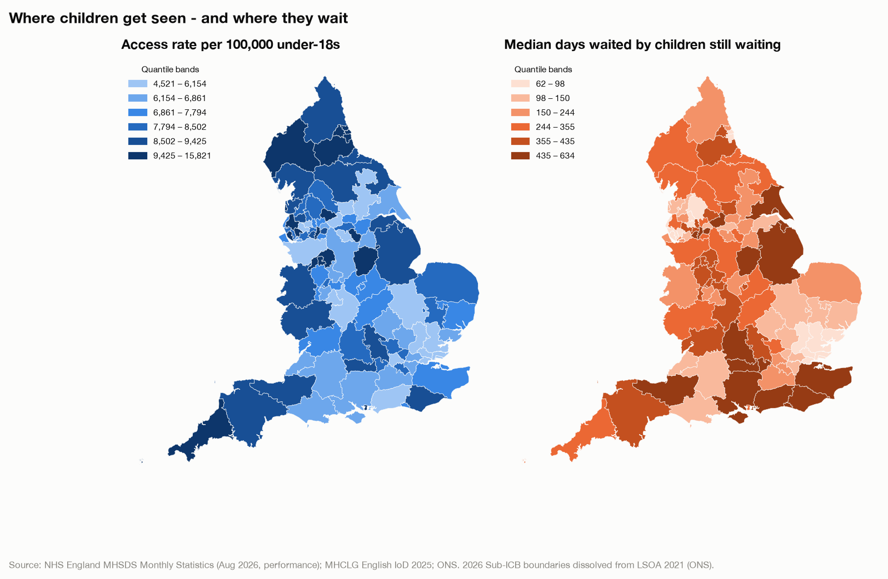
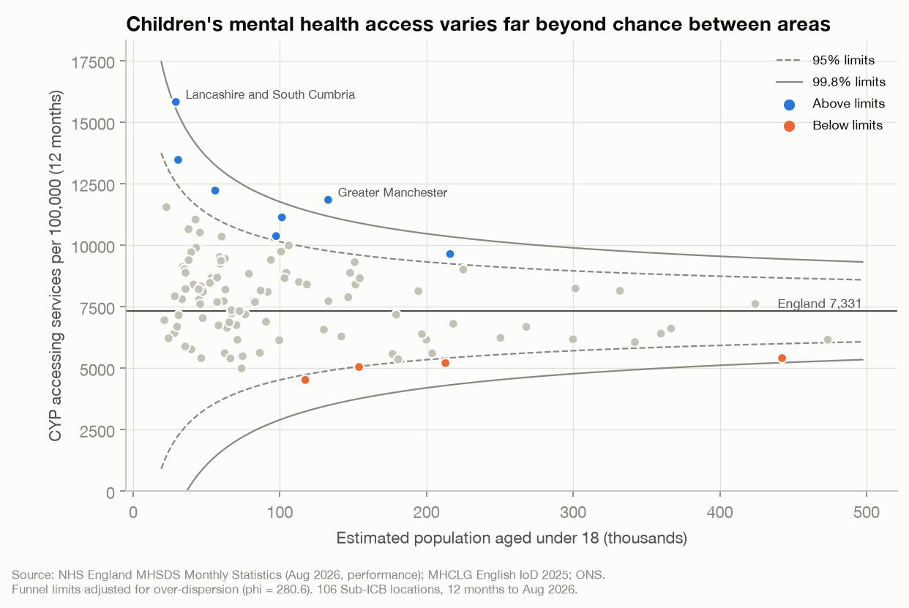
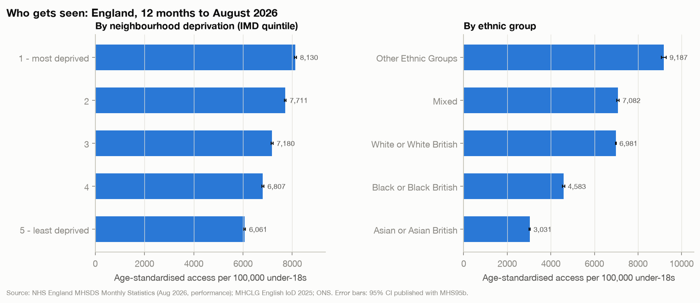
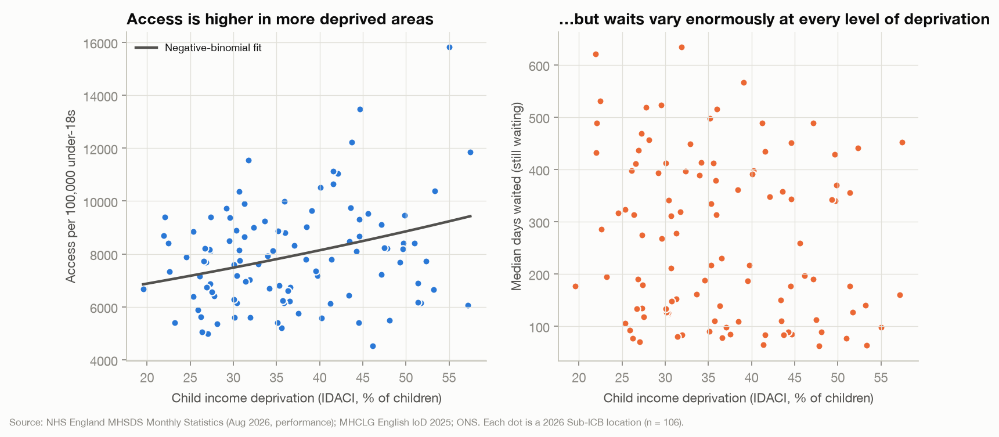
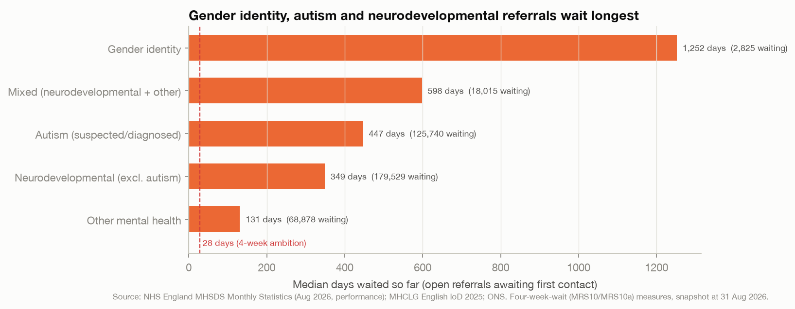

# Children's Mental Health Services in England: Who Gets Seen, and Who Waits?

[](https://github.com/Abheetsbabbar/children-mental-health-access-inequalities/actions/workflows/ci.yml)


> An end-to-end analysis of **access to and waiting times for children and young
> people's mental health services (CYPMHS)** across all 106 NHS Sub-ICB areas in
> England. It uses the latest NHS England data (12 months to August 2026), the new
> **English Indices of Deprivation 2025**, and the **April 2026 NHS geography**.

Part 1 of a three-project portfolio on children and young people's mental health:

| # | Project | Question |
|---|---|---|
| **1** | **Access & inequalities (this repo)** | Where, and for whom, is access to children's mental-health care unequal? |
| 2 | Demand forecasting & waiting-list simulation *(coming 17 Nov 2026)* | How many referrals are coming, and what capacity would clear the waiting list? |
| 3 | Explainable self-harm risk model *(coming 24 Nov 2026)* | Which local social factors explain youth self-harm admissions, and which areas exceed expectation? |

---

## Key findings

| | Finding | Evidence |
|---|---|---|
| ⏱️ | **Only 24% of children got meaningful help within 4 weeks** (Jun–Aug 2026). **279,604** referrals were still waiting for a first contact, with a median wait so far of **290 days**. | MRS08b, MRS10, MRS10a |
| 🧩 | **Neurodevelopmental, autism and gender-identity referrals wait longest**: medians of **349, 447 and 1,252 days** so far, against **131 days** for other mental-health referrals. | MRS10a by pathway |
| 🌍 | **Asian children are seen at 0.43× the rate of White children**, and **Black children at 0.66×** (age-standardised; 95% CIs 0.43–0.44 and 0.65–0.66). | MHS95b, rate ratios |
| 📉 | Access **rises with deprivation**: 8,130 vs 6,061 per 100k (most vs least deprived quintile, rate ratio **1.34**; SII **+2,557 per 100k**). Need is also higher in deprived areas, so this does not by itself show fair provision ([limitations](docs/limitations_and_ethics.md)). | MHS95b, SII |
| 🗺️ | **Postcode variation is 3.5-fold**: from 4,521 to 15,821 children seen per 100k. Even after widening limits for over-dispersion (φ ≈ 281), **11 of 106 areas** sit outside the 95% funnel limits. | Funnel plot |
| ⚖️ | The deprivation gap in **waits** is small: 23.7% vs 25.1% helped within 4 weeks (Core20 vs the rest, *p* < 0.001). Across areas, deprivation does **not** predict how long children wait (Spearman ρ = −0.16, 95% CI −0.35 to 0.04). Waits look driven by **local service capacity, not area need**. | z-test, bootstrap ρ |

<p align="center"></p>

<details>
<summary><b>More figures</b> (funnel plot, equity breakdowns, deprivation, waits by pathway)</summary>





</details>

---

## Techniques and technologies

| Area | What was used | Where |
|---|---|---|
| **Data engineering** | Automated ingestion from NHS England, gov.uk and the ONS ArcGIS REST API (paginated); **DuckDB SQL warehouse** with staging → mart layers; long → wide `PIVOT`; window functions (`QUALIFY`) for de-duplication; Parquet outputs | [`download.py`](src/access_inequalities/download.py), [`sql/`](sql/), [`build.py`](src/access_inequalities/build.py) |
| **Geospatial** | GeoPandas/Shapely: dissolved 33,755 LSOA polygons into the **April 2026** Sub-ICB boundaries ONS hasn't yet published; geometry repair, sliver removal and simplification in British National Grid | [`build.py`](src/access_inequalities/build.py) |
| **Statistics** | Over-dispersion-adjusted **funnel plots** (Spiegelhalter); **Slope/Relative Index of Inequality**; **negative-binomial regression** with a population offset (incidence-rate ratios); Spearman ρ with **bootstrap CIs**; two-proportion z-test; rate ratios with log-normal CIs; population-weighted indices | [`stats.py`](src/access_inequalities/stats.py) |
| **Visualisation** | Matplotlib publication figures (one consistent palette, quantile choropleths, source lines); interactive **Plotly + Streamlit** dashboard with a region filter, choropleth map, funnel plot, LOWESS trend and data table/CSV export | [`analysis.py`](src/access_inequalities/analysis.py), [`app/`](app/streamlit_app.py) |
| **Quality assurance** | **pytest** known-answer tests; **pandera data contracts** (types, ranges, grain, reconciliation to England totals); Streamlit `AppTest` smoke tests; **ruff** linting; **GitHub Actions CI** | [`tests/`](tests/), [`.github/workflows/`](.github/workflows/ci.yml) |
| **Governance** | Open Government Licence attribution, disclosure-control handling, a limitations and ethics statement | [`docs/`](docs/) |

**Stack:** Python 3.11 · DuckDB · pandas · GeoPandas · statsmodels · SciPy · Matplotlib · Plotly · Streamlit · pandera · pytest · ruff · GitHub Actions

---

## Repository structure

```
children-mental-health-access-inequalities/
├── README.md                  ← you are here
├── Makefile                   ← one-command pipeline: make all
├── pyproject.toml             ← dependencies and tool config
├── src/access_inequalities/
│   ├── config.py              ← source URLs, paths, measure definitions
│   ├── download.py            ← fetch raw open data (idempotent)
│   ├── build.py               ← DuckDB warehouse + boundary building
│   ├── stats.py               ← statistical methods (pure, unit-tested)
│   ├── analysis.py            ← figures + reports/results.json
│   └── style.py               ← shared chart styling
├── sql/
│   ├── 01_staging.sql         ← type, trim, de-duplicate raw sources
│   └── 02_marts.sql           ← LSOA → Sub-ICB aggregation, pivots, joins
├── app/streamlit_app.py       ← interactive dashboard
├── data/
│   ├── raw/                   ← downloads (git-ignored, ~250 MB)
│   └── processed/             ← small analysis-ready Parquet + GeoJSON (committed)
├── reports/
│   ├── figures/               ← PNG charts used in this README
│   └── results.json           ← every number quoted above
├── docs/
│   ├── methodology.md         ← pipeline, data decisions, statistical methods
│   ├── data_dictionary.md     ← every column, its definition and source
│   ├── data_sources.md        ← datasets, URLs, licences, attribution
│   └── limitations_and_ethics.md
└── tests/                     ← unit, data-contract and dashboard tests
```

## How to run it

```bash
git clone https://github.com/Abheetsbabbar/children-mental-health-access-inequalities.git
cd children-mental-health-access-inequalities
python -m venv .venv && source .venv/bin/activate
make install
```

```bash
make app        # dashboard from committed processed data (no download needed)
```

```bash
make all        # full rebuild: download → build → analysis → tests (~3 minutes)
```

## Documentation

- [Methodology](docs/methodology.md): pipeline design, data-quality issues found and how each was handled, statistical methods with formulas
- [Data dictionary](docs/data_dictionary.md): every column, its grain and its source measure
- [Data sources and licensing](docs/data_sources.md)
- [Limitations and ethics](docs/limitations_and_ethics.md): what the analysis can and cannot conclude

## Data and independence

The data is open and aggregate: no patient-level information is used. Copyright ©
NHS England 2026, MHCLG and ONS, licensed under the
[Open Government Licence v3.0](https://www.nationalarchives.gov.uk/doc/open-government-licence/version/3/).
Contains OS data © Crown copyright 2026. This is an independent portfolio project,
not endorsed by NHS England or any NHS organisation.

**Author:** Abheet Singh Babbar, MSc Data Science, University of Surrey
